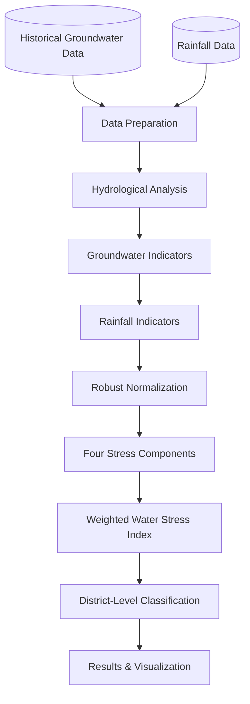

# 💧 Groundwater & Water Stress Assessment Model (India)

A Python-based hydrological assessment model and interactive dashboard for evaluating groundwater depletion, seasonal recharge, rainfall dependency, and district-level water stress using historical groundwater and rainfall data from India.

The project implements a **Water Stress Index (WSI)** that combines four normalized indicators into a composite score ranging from 0 to 100. Districts are subsequently classified into four water-stress categories: Low, Moderate, High, and Critical.

## 🎯 Target / Problem Statement

Groundwater is a critical source of water for agricultural, domestic, and industrial activities across India. However, unsustainable extraction rates, erratic climate patterns, and geographic variations in natural recharge present severe challenges to long-term water security.

This model directly addresses the following core problems:

* **📍 Map Pin / Hotspot Identification:** Resolves the challenge of pinpointing regions experiencing severe groundwater depletion by evaluating historical trend data rather than relying solely on static water levels.

* **📊 Bar Chart / Hydrological Dynamics:** Standardizes the calculation of crucial groundwater dynamics—such as long-term depletion rates, seasonal water-table recovery, and gross recharge—from multi-decadal observation datasets.

* **🔄 Refresh / Data Integration:** Synthesizes disparate hydro-climatic indicators (groundwater depth, depletion trends, annual rainfall, and recharge efficiency) into a single, comparative **Water Stress Index (WSI)** for effective district-level categorization.

* **📈 Trending Up / Resource Planning:** Addresses the lack of accessible decision-support tools by providing interactive projections of future groundwater depths and critical threshold timelines.

## ⚡ Features

* **📉 Trending Down / Depletion Analysis:** Estimates the annual groundwater depletion rate using Ordinary Least Squares (OLS) regression.

* **🌧️ Cloud Rain / Seasonal Recovery:** Calculates groundwater-level rise between pre-monsoon and post-monsoon periods.

* **💧 Droplet / Recharge Estimation:** Implements the Water Table Fluctuation (WTF) method.

* **Scale / Recharge Ratio:** Estimates recharge relative to annual rainfall.

* **🌦️ Sun Rain / Monsoon Dependency:** Measures the proportion of annual rainfall received during June–September.

* **🔮 Sparkles / Future Projection:** Estimates future groundwater depth and years to reach a specified critical depth.

* **🧮 Calculator / Composite Index:** Combines four hydrological and climatic indicators using weighted aggregation.

* **🏷️ Tag / Classification:** Categorizes districts into four water-stress levels.

* **🖥️ Monitor / Interactive Dashboard:** Streamlit application providing spatial visualization, ranking, exploratory analysis, and parameter tuning.

## 📂 Data Sources

| Dataset | Source | Description | 
| ----- | ----- | ----- | 
| **Indian Groundwater Level Data (1970–2025)** | Central Ground Water Board (CGWB) | Historical monitoring-station groundwater-depth observations | 
| **District-wise Rainfall Normals** | India Meteorological Department (IMD) | District-level annual and June–September rainfall normals | 

### 📁 Expected Raw Data Directory

Place raw input files in `data/raw/`:

```
data/
└── raw/
    ├── india_groundwater_level_data_cgwb_1970-2025.csv
    └── district_wise_rainfall_normal.xlsx
```

## 🛠️ Technology Stack

| Category | Technology | Purpose | 
| ----- | ----- | ----- | 
| **Language** | Python 3.10+ | Core implementation | 
| **Data Processing** | Pandas, NumPy | Data manipulation and vectorized calculations | 
| **Statistical Analysis** | OLS Regression, SciPy | Hydrological trend estimation and correlations | 
| **Data Visualization** | Plotly, Matplotlib | Dynamic interactive charts and geographic maps | 
| **Web Application** | Streamlit | Web interactive application interface | 

## 🌴 Project Structure

```
water-stress-assessment/
│
├── app.py                      # Interactive Streamlit application
│
├── src/
│   ├── build_data.py           # Preprocessing pipeline script
│   └── formulas.py             # Hydrological equations & model calculations
│
├── data/
│   ├── raw/
│   │   ├── india_groundwater_level_data_cgwb_1970-2025.csv
│   │   └── district_wise_rainfall_normal.xlsx
│   │
│   └── processed/
│       ├── district_metrics.csv
│       ├── district_year.csv
│       └── stations.csv
│
├── requirements.txt            # Project dependencies
├── README.md                   # Project documentation
└── .gitignore                  # Git ignore rules
```

## 🔄 Project Workflow



## 📐 Methodology

The assessment methodology consists of three major stages:

1. Hydrological and rainfall indicator calculations.
2. Normalization and composite stress calculation.
3. District-level water stress classification.

### 1. Groundwater Hydrological Indicators

#### 1.1 Groundwater Depletion Rate

Estimates the annual change in groundwater depth using Ordinary Least Squares linear regression.

$$
D_r = \frac{n\sum xy-\sum x\sum y}{n\sum x^2-(\sum x)^2}
$$

Where:

* $D_r$: Groundwater depletion rate (m/year).
* $x$: Observation year.
* $y$: Groundwater depth (m).
* $n$: Number of valid observations.

**Interpretation:**

* **Positive value:** Groundwater table is declining.
* **Negative value:** Groundwater table is recovering.
* **Zero:** No linear change.

#### 1.2 Seasonal Groundwater Rise

Measures the groundwater-level rise between pre-monsoon and post-monsoon observations.

$$
\Delta h = \max(D_{\text{pre}}-D_{\text{post}},0)
$$

Where:

* $D_{\text{pre}}$: Pre-monsoon groundwater depth (m).
* $D_{\text{post}}$: Post-monsoon groundwater depth (m).
* $\Delta h$: Seasonal groundwater rise (m).

#### 1.3 Groundwater Recharge Estimation

Implements the Water Table Fluctuation (WTF) method to estimate recharge using specific yield and seasonal groundwater rise.

$$
R=S_y\times\Delta h\times1000
$$

Where:

* $R$: Estimated groundwater recharge (mm).
* $S_y$: Specific yield (dimensionless).
* $\Delta h$: Seasonal groundwater rise (m).
* $1000$: Metre-to-millimetre conversion factor.

#### 1.4 Recharge Ratio

Calculates estimated groundwater recharge as a percentage of annual rainfall.

$$
RR=\frac{R}{P}\times100
$$

Where:

* $R$: Estimated groundwater recharge (mm).
* $P$: Annual rainfall (mm).
* $RR$: Recharge-to-rainfall ratio (%).

### 2. Rainfall Indicators

#### 2.1 Monsoon Rainfall Share

Measures the contribution of June–September rainfall to total annual rainfall.

$$
MS=\frac{P_{\text{JJAS}}}{P_{\text{annual}}}\times100
$$

Where:

* $P_{\text{JJAS}}$: June–September rainfall (mm).
* $P_{\text{annual}}$: Annual rainfall (mm).
* $MS$: Monsoon rainfall share (%).

### 3. Groundwater Projection

#### 3.1 Years to Reach Critical Groundwater Depth

Estimates the time required for groundwater depth to reach a specified threshold, assuming a constant depletion rate.

$$
t=\frac{D_{\text{limit}}-D_{\text{now}}}{D_r}
$$

*The calculation is applied only when the depletion rate is positive.*

#### 3.2 Projected Groundwater Depth

Projects future groundwater depth using a linear trend assumption.

$$
D(t)=D_{\text{now}}+D_r\times t
$$

Where:

* $D(t)$: Projected groundwater depth.
* $D_{\text{now}}$: Current groundwater depth.
* $D_r$: Annual depletion rate.
* $t$: Projection period (years).

## 🧮 Composite Water Stress Index (WSI)

The Water Stress Index combines four indicators into a single score ranging from 0 to 100.

### 1. Robust Min-Max Normalization

All indicators are normalized to a common 0–1 scale using percentile-based min-max scaling.

$$
Z=\frac{X-P_5}{P_{95}-P_5}
$$

*Values are clipped to the interval* $[0, 1]$.

Where:

* $X$: Original indicator value.
* $P_5$: Fifth percentile.
* $P_{95}$: Ninety-fifth percentile.
* $Z$: Normalized indicator.

This approach reduces the influence of extreme observations compared with conventional minimum-maximum scaling.

### 2. Stress Components

Four normalized stress components are calculated.

| Component | Indicator | Calculation | Stress Direction | 
| ----- | ----- | ----- | ----- | 
| **Depth** | Pre-monsoon groundwater depth | $Z(D_{\text{pre}})$ | Higher depth = Higher stress | 
| **Trend** | Groundwater depletion rate | $Z(D_r)$ | Higher rate = Higher stress | 
| **Rain** | Annual rainfall | $1-Z(P_{\text{annual}})$ | Lower rainfall = Higher stress | 
| **Recharge** | Recharge ratio | $1-Z(RR)$ | Lower recharge = Higher stress | 

### 3. Weighted Water Stress Index

The four components are combined using a weighted arithmetic aggregation method.

$$
WSI=100\times \frac{\sum_{i=1}^{n}w_iC_i}{\sum_{i=1}^{n}w_i}
$$

Where:

* $WSI$: Composite Water Stress Index.
* $w_i$: Weight assigned to each component.
* $C_i$: Normalized stress component.
* $n$: Number of components.
* $100$: Converts the score into a 0–100 scale.

### 4. Water Stress Classification

The resulting WSI is classified into four categories.

| WSI Range | Category | Description | 
| ----- | ----- | ----- | 
| **< 35** | 🟢 Low | Relatively lower water stress | 
| **35 – 49.99** | 🟡 Moderate | Moderate water stress | 
| **50 – 64.99** | 🟠 High | High water stress | 
| **65 – 100** | 🔴 Critical | Critical water stress | 

## 💻 Installation & Setup

1. **Clone the repository:**

   ```bash
   git clone https://github.com/USERNAME/REPOSITORY.git
   cd REPOSITORY
   ```

2. **Create and activate a virtual environment:**

   * **Windows:**

     ```cmd
     python -m venv venv
     venv\Scripts\activate
     ```

   * **Linux/macOS:**

     ```bash
     python3 -m venv venv
     source venv/bin/activate
     ```

3. **Install dependencies:**

   ```bash
   pip install numpy pandas matplotlib plotly streamlit openpyxl scipy
   ```

4. **Generate processed datasets:**

   ```bash
   python src/build_data.py
   ```

5. **Run the Streamlit application:**

   ```bash
   streamlit run app.py
   ```

## 📋 Core Python Functions

| Function | Description | 
| ----- | ----- | 
| `depletion_rate()` | Calculates groundwater depletion rate using OLS regression | 
| `seasonal_rise()` | Calculates seasonal groundwater rise | 
| `recharge_wtf()` | Estimates groundwater recharge via WTF method | 
| `recharge_ratio()` | Calculates recharge-to-rainfall ratio | 
| `monsoon_share()` | Calculates monsoon rainfall dependency | 
| `years_to_reach()` | Estimates years to reach critical groundwater depth | 
| `projected_depth()` | Projects future groundwater depth | 
| `minmax()` | Performs robust min-max normalization | 
| `stress_components()` | Generates normalized stress components | 
| `water_stress_index()` | Calculates composite WSI score | 
| `classify()` | Assigns water stress categories | 

## ⚠️ Scientific Considerations & Limitations

* **Trend Assumptions:** Groundwater depletion rates are estimated using historical linear trends and do not represent guaranteed future behavior.
* **WTF Simplification:** The WTF recharge estimate uses seasonal water-table fluctuations and does not explicitly account for groundwater pumping, lateral flows, or other water-balance components during the monsoon.
* **Relative Normalization:** Annual rainfall normalization and WSI scores represent relative conditions within the analyzed dataset, not absolute global thresholds.
* **Weight Sensitivity:** WSI results depend on component weights and normalization reference parameters.
* **Scope:** The model is intended for research and exploratory water-resource assessment, not as an operational regulatory tool.

## 🔬 Research Applications

This model can support:

* District-level groundwater stress assessment.
* Identification of regional groundwater depletion hotspots.
* Comparative hydro-climatic evaluation across administrative boundaries.
* Analysis of seasonal recovery patterns against local rainfall.
* Academic modeling and decision-support tool demonstrations.

## 🚀 Future Improvements

* Incorporate long-term rainfall anomalies (e.g., Standardized Precipitation Index).
* Integrate groundwater extraction volumes and agricultural water-demand data.
* Refine specific yield parameters using localized hydrogeological maps.
* Implement GIS choropleth mapping at the district boundary level.

## 📌 Disclaimer

This project is developed for academic, research, and educational purposes. Its outputs represent indicator-based estimates and relative water-stress assessments. They should not be treated as official government classifications without independent field validation.

## 📜 License

Specify an appropriate open-source license before distributing this project.
